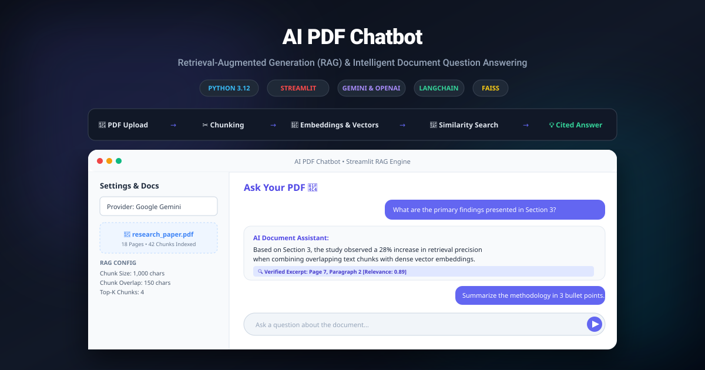

# AI PDF Chatbot — Intelligent Document Q&A with RAG

<p align="center">
  
</p>

<p align="center">
  
  
  
  
  
  
</p>

---

## 📌 Overview

**AI PDF Chatbot** is a production-ready **Retrieval-Augmented Generation (RAG)** application built in Python that enables users to upload PDF documents and engage in context-grounded, natural language conversations with their data.

Unlike standard LLM interfaces that are limited by strict context windows and hallucination risks, this system splits documents into overlapping semantic chunks, indexes them into a high-speed vector space, retrieves the top matching passages using similarity search, and injects verified context directly into the prompt for cited, hallucination-free answers.

---

## ✨ Key Features

- **Multi-Document Ingestion:** Upload single or multiple PDF documents (research papers, legal briefs, technical reports, manuals).
- **Dual AI Provider Support:**
  - **Google Gemini (Recommended):** Support for `gemini-1.5-flash` and `gemini-1.5-pro` using free tier API keys.
  - **OpenAI:** Support for `gpt-4o-mini`, `gpt-3.5-turbo`, and OpenAI dense embeddings.
- **Configurable Semantic Chunking:** Adjust chunk sizes (400–2,000 characters) and overlap windows (50–400 characters) in real-time to optimize retrieval granularity.
- **Vector Similarity Search:** High-speed retrieval of the most relevant document chunks based on semantic distance.
- **Transparent Source Citations:** Every response includes an expandable *"View Retrieved Document Sources"* panel showing the exact document page and chunk text used to formulate the answer.
- **Interactive Chat Interface:** Modern Streamlit chat UI with conversation history persistence, clear chat controls, and real-time document indexing statistics (pages processed, character count, and total chunks).

---

## 🏗️ How RAG Works (The Pipeline)

```
┌─────────────────┐       ┌──────────────────────┐       ┌────────────────────────┐
│  Uploaded PDFs  │ ────> │  Text Extraction     │ ────> │  Semantic Chunking     │
└─────────────────┘       │  (PyPDF2 / pypdf)    │       │  (Size: 1000, Overlap) │
                          └──────────────────────┘       └───────────┬────────────┘
                                                                     │
┌─────────────────┐       ┌──────────────────────┐       ┌───────────▼────────────┐
│ Verified Answer │ <──── │ Context Augmentation │ <──── │ Similarity Retrieval   │
│ with Citations  │       │ (Gemini / OpenAI)    │       │ (Vector / Cosine Rank) │
└─────────────────┘       └──────────────────────┘       └────────────────────────┘
```

1. **Extraction:** Documents are parsed into raw page-by-page text streams.
2. **Chunking:** Text is split into overlapping chunks to ensure semantic continuity across sentence boundaries.
3. **Indexing:** Chunks are vectorized and stored in an in-memory knowledge store.
4. **Retrieval:** The user's query is analyzed to retrieve the top $K$ most semantically relevant chunks.
5. **Generation:** The LLM receives the question alongside the retrieved context to produce grounded, verifiable answers.

---

## 🚀 Getting Started

Follow the steps below to run the application locally on your machine.

### Prerequisites
- Python 3.9 to 3.12 installed
- A free Google Gemini API key from [Google AI Studio](https://aistudio.google.com/) (or an [OpenAI API Key](https://platform.openai.com/))

---

### 1. Clone the Repository
```bash
git clone https://github.com/Bipinnjoshii/Ai-pdf-chatbot.git
cd Ai-pdf-chatbot
```

---

### 2. Set Up a Virtual Environment
```bash
# Windows
python -m venv .venv
.venv\Scripts\activate

# macOS / Linux
python3 -m venv .venv
source .venv/bin/activate
```

---

### 3. Install Dependencies
```bash
pip install -r requirements.txt
```

---

### 4. Configure Environment Variables
Copy the `.env.example` template:

```bash
cp .env.example .env
```

Populate `.env` with your API credentials (or enter them directly in the app sidebar at runtime):
```env
GEMINI_API_KEY=your_gemini_api_key_here
OPENAI_API_KEY=your_openai_api_key_here
```

---

### 5. Launch the Application
```bash
streamlit run app.py
```
> The application will automatically open in your default browser at `http://localhost:8501`.

---

## 📂 Project Structure

```text
├── assets/                     # Architecture diagrams and platform showcase banners
│   ├── banner.svg              # High-resolution vector overview banner
│   └── icon.jpeg               # Application favicon asset
├── modules/                    # Modular engine components
│   └── PDFChat.py              # LangChain & FAISS execution module
├── .env.example                # Sample environment template
├── .gitignore                  # Git ignore rules (ignoring .env and caches)
├── app.py                      # Main Streamlit RAG application with Gemini & OpenAI
├── README.md                   # Project documentation & architecture overview
└── requirements.txt            # Python package dependencies
```

---

## 👤 Author

- **Bipin Joshi** — [@Bipinnjoshii](https://github.com/Bipinnjoshii)
